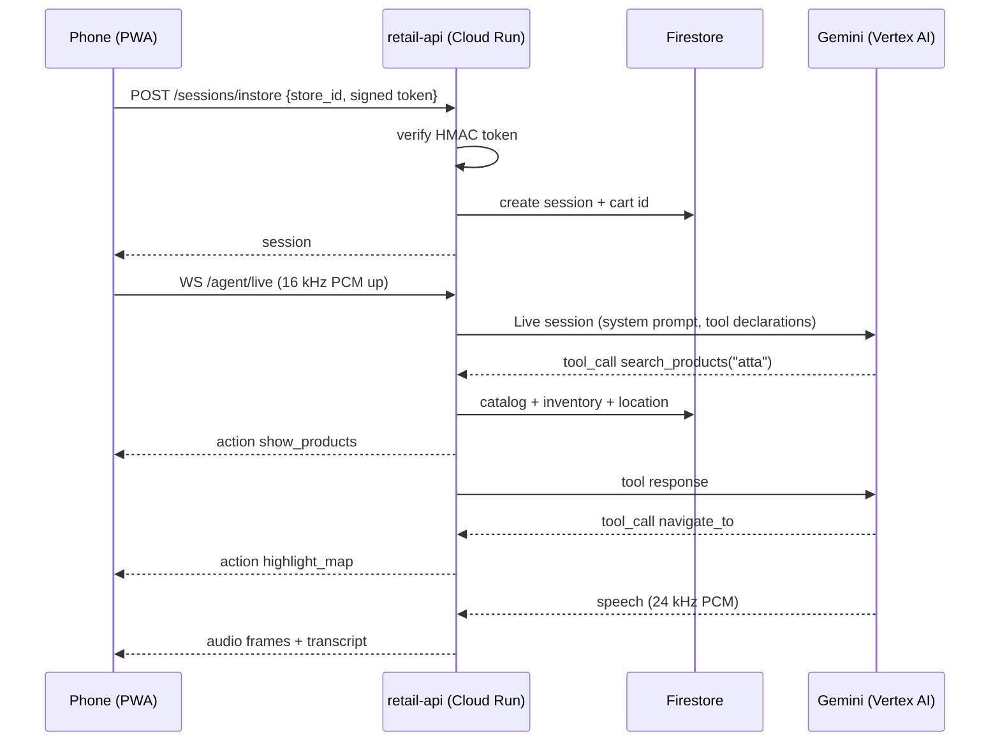
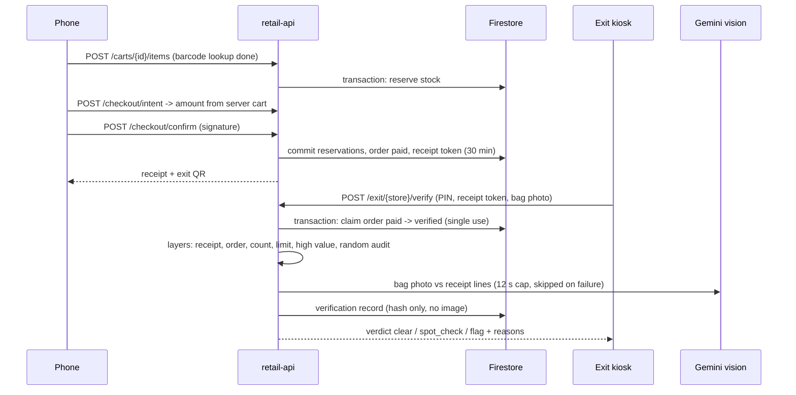

# Architecture: key sequences

See `hld.md` for components and trust boundaries, `security.md` for controls, `lld/` for module designs.

## In-store visit



## Scan, pay, exit



## Nightly forecast and reorder

```mermaid
sequenceDiagram
  participant S as Cloud Scheduler
  participant A as retail-api
  participant B as BigQuery / BigQuery ML
  participant F as Firestore
  participant O as Owner dashboard
  participant G as Gemini Flash
  S->>A: POST /jobs/forecast?store_id (X-Job-Key)
  A->>F: paid orders since last sync
  A->>B: load into retail.sales; rebuild daily_product_sales
  A->>B: CREATE MODEL ARIMA_PLUS (per store); ML.FORECAST 14 days
  A->>F: forecasts/{product_id}
  O->>A: POST /owner/{store}/reorders/draft
  A->>F: inventory + forecasts -> candidates by supplier (manual point as floor)
  A->>G: one JSON call per supplier: reasons for urgent lines + summary
  A->>F: po_drafts (status draft)
  O->>A: approve / reject
  A->>F: status, supplier email text, audit entry
```
