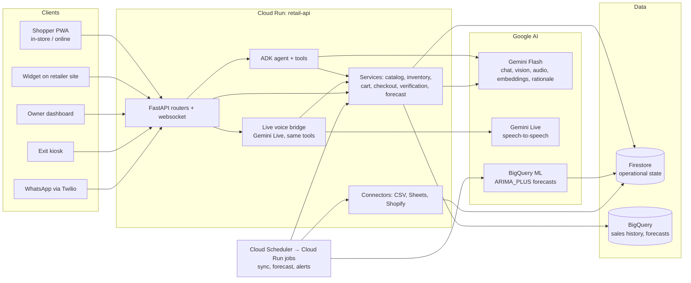

# High-Level Design

One AI commerce agent and one inventory truth across the physical store, the online store, and the owner's back office, on top of the software the retailer already uses.

## 1. Components



| Component | Runs on | Owns |
|---|---|---|
| Shopper PWA | Firebase Hosting | QR session, chat, scan, cart, checkout, map |
| Widget | Firebase Hosting (`widget.js`) | Same chat on any retailer website |
| Owner dashboard | Firebase Hosting (`/owner`) | Inventory, reorders, signals, loss, connectors |
| Exit kiosk | Firebase Hosting (`/kiosk`) | Receipt scan, bag photo, verdict |
| retail-api | Cloud Run | All business logic, the only writer to Firestore and BigQuery |
| Jobs | Cloud Run jobs via Scheduler | Connector sync, forecast, alerts |
| Firestore | Google Cloud | Catalog, inventory, sessions, carts, orders, verifications, drafts, audit |
| BigQuery | Google Cloud | Sales history, daily aggregates, ARIMA_PLUS forecasts |
| Gemini | Vertex AI, `global` endpoint | `gemini-3.5-flash` for chat, vision, transcription and rationale; `gemini-live-2.5-flash` for speech-to-speech; `gemini-embedding-001` for search |
| BigQuery ML | `retail` dataset | `ARIMA_PLUS` per store, retrained nightly by the forecast job |
| Owner dashboard | Firebase Hosting (`/owner`) | Firebase Google sign-in; overview, inventory, reorders, signals, loss, connectors, assistant with live voice |

## 2. Core data flows

**Live voice turn.** Browser streams 16 kHz PCM over `WS /agent/live`; the bridge relays audio to Gemini Live, runs each tool call locally, forwards tool results as UI actions, streams 24 kHz speech back; interruptions flush playback. Same tools, same gating, for shoppers and owners.

**Shopper chat turn.** Client → `POST /agent/chat` → ADK agent picks tools → tools read Firestore → agent reply streamed as SSE `token` and `action` events → UI renders cards, map, cart from `action` events only.

**Scan and checkout.** Barcode → `GET /products/by-barcode` → `add_to_cart` reserves stock in a Firestore transaction → `POST /checkout/intent` → sandbox payment → `POST /checkout/confirm` verifies signature, commits reservations, writes order, appends sale to BigQuery, returns signed receipt token.

**Exit verification.** Kiosk → `POST /exit/verify` with receipt token and optional bag photo → deterministic layers → Gemini vision confidence → verdict stored, image discarded.

**Owner reorder.** Nightly job syncs paid orders to BigQuery, trains ARIMA_PLUS, writes 14-day forecasts to Firestore → reorder point = forecast × lead time + safety stock (owner's manual value is a floor) → low-stock items grouped by supplier → one Gemini call per supplier writes the rationale → draft waits in the approval inbox → owner approves → supplier email text generated and audited (not sent).

**Connector sync.** Scheduler → `POST /jobs/sync` → connector pulls rows → mapped with the store's column mapping → upsert products and inventory.

## 3. Trust boundaries and security

```
Internet ──► Firebase Hosting (static) ──► retail-api on Cloud Run ──► Firestore / BigQuery / Gemini
                                            ▲
                       Cloud Scheduler ─────┘ (OIDC token, jobs only)
```

| Boundary | Control |
|---|---|
| Client → API | HTTPS only. CORS restricted to the hosting origin and localhost. |
| Shopper identity | Firebase Auth anonymous session. ID token sent as `Authorization: Bearer`. Session documents keyed by a server-generated id; a client can only act on its own session. |
| In-store entry | Entrance QR carries an HMAC token signed with `QR_SESSION_SIGNING_KEY`. Sessions expire after 4 hours. Self-checkout only in `instore` mode. |
| Owner endpoints | Firebase ID token verified server-side; `users/{uid}.stores` must contain the `store_id`. No owner data is readable from the client SDK. |
| Jobs endpoints | `X-Job-Key` shared secret from Secret Manager, constant-time compare; Cloud Scheduler sends it. |
| Owner identity | Firebase Google sign-in; token verified server-side; membership from `users/{uid}.stores` or a verified email listed in `stores/{id}.owner_emails`. |
| Kiosk | Store PIN header, constant-time compare, lockout after 5 failures; PIN never in public responses. |
| Live voice | Session id is the credential; one socket per session; 15 min cap; frame size cap; owner sessions only from the authenticated owner endpoint. |
| Firestore | Security rules deny all client reads and writes except the shopper's own session, cart, and orders. Everything else goes through the API. |
| Secrets | Secret Manager mounted as env vars on Cloud Run. Locally in `.env`, git-ignored. Never in code or logs. |
| Payments | Razorpay test mode or mock. Signatures verified with HMAC before stock is committed; mock refused in prod. |
| Receipts | Receipt token is a signed JWT, 30 minute expiry, single use (marked used inside the verdict transaction). |
| WhatsApp | Twilio request signature verified. |
| Uploads | Images limited to 5 MB, content type checked, bag photos processed in memory and discarded. Product photos stored only if the shopper confirms. |
| Input validation | Every request body is a pydantic model. `store_id` and ids match `^[a-z0-9-]{3,40}$`. CSV imports capped at 5 MB and 10 000 rows, headers whitelisted. |
| Agent | Tools are gated by mode. Tool results are the only source of truth for stock, price, location. Max 6 tool calls per turn. Rate limit per session on `/agent/chat`. |
| Audit | Every agent write, approval, verification, and import appends to `stores/{store_id}/audit`. |
| Privacy | No bag images stored. Verification keeps verdict, confidence, and image hash. Retention job deletes verifications older than 90 days. |
| Supply chain | Python and npm dependencies pinned. CI runs tests and build on every push. |

## 4. Multi-tenancy

Every document carries or is nested under `store_id`. The API resolves `store_id` from the session (shopper) or from the owner's membership (owner), never from a free query parameter on write paths. A second store can be onboarded by CSV with its own column mapping; nothing else changes.

## 5. Environments

| | Dev (laptop) | Demo (Cloud) |
|---|---|---|
| API | uvicorn on :8080 | Cloud Run `retail-api`, min 1 instance during judging |
| Frontend | next dev on :3000 | Firebase Hosting |
| Firestore | emulator for tests, real DB for manual runs | real DB |
| Gemini | AI Studio key | AI Studio key, Vertex AI once billing is linked |
| Secrets | `.env` | Secret Manager |

## 6. Non-goals for the hackathon

Indoor positioning or AR navigation, live payments, Shopify write-back, 3D avatar (stretch), email digests, multi-region.


## 7. Where each control is implemented and tested

See `security.md` for the control-by-control map to code paths and test names, and the list of known gaps.
